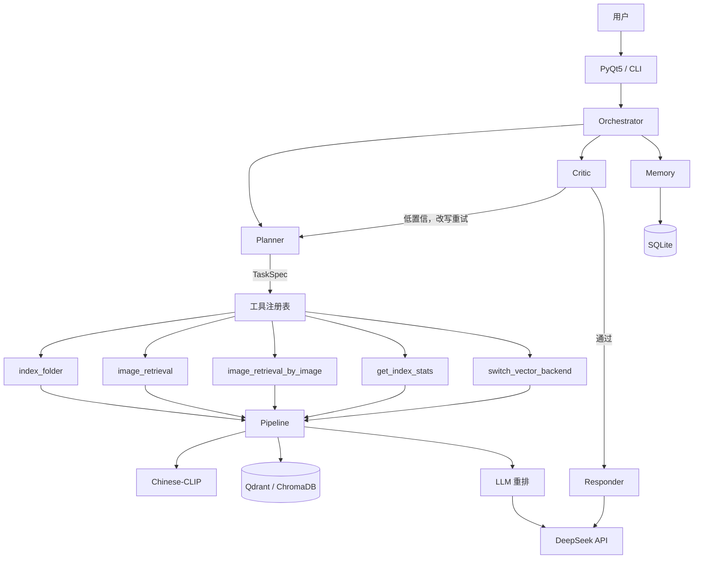

# imgsearch-agent

基于 **ReAct** 的多模态图像检索 Agent。

它不是「输入查询 → 返回结果」的被动检索，而是会自己判断：什么时候该检索、结果够不够可信、要不要改写查询重试，最后用自然语言把结果讲清楚。

图像与文本用 Chinese-CLIP 映射到同一语义空间，向量库负责快速召回，BLIP 生成图像描述供大模型做语义重排。所有图像处理都在本机完成，只有可选的 LLM 重排会调用 API。

## 核心能力

- **以文搜图**：用自然语言描述找图，中文语义对齐
- **三级检索**：跨模态嵌入 → 向量召回 Top-K → 大模型重排
- **双向量库**：ChromaDB 与 Qdrant 共用一套接口，改配置即可切换
- **ReAct 编排**：Planner 决策、Critic 校验、低置信改写重试、Responder 总结
- **持久记忆**：对话与动作轨迹落 SQLite，可按 trace_id 回溯
- **桌面应用**：PyQt5 原生窗口，不占端口、不依赖浏览器
- **多 LLM 后端**：DeepSeek API / Ollama / 本地 Transformers 三选一
- **可注册工具**：新增能力只需继承 `BaseTool`，不改 Agent 主流程

## 架构

四层结构，Agent 工具与 CLI 共用同一套内核：

```
Agent 工具（LLM 调用）   CLI（人手动调用）
      │                        │
      └────────┬───────────────┘
               ▼
        Core Service（Pipeline / Searcher / Indexer / Encoder）
               ▼
        检索模型与向量库（Chinese-CLIP / BLIP / Qdrant / Chroma / LLM 重排）
```

| 工具 | 作用 |
| --- | --- |
| `image_retrieval` | 文本检索图片，支持 `folder_path` 限定目录 |
| `image_retrieval_by_image` | 以图搜图 |
| `index_folder` | 对指定文件夹增量建索引 |
| `get_index_stats` | 查询图片数量、向量库类型、设备 |
| `switch_vector_backend` | 切换 Chroma / Qdrant |
| `folder_scan` | 扫描文件夹并统计图片数量 |



更详细的分层、调用链路与安全收口见 [docs/architecture.md](docs/architecture.md)。


## 快速开始

```powershell
# 1. 安装依赖
pip install -r requirements-core.txt

# 2. 下载 CLIP + BLIP（约 1.6GB，走 hf-mirror）
python scripts\download_models.py

# 3. 生成 Agent 配置
python scripts\init_agent_config.py

# 4. 配置 API Key（环境变量优先，不写进文件）
setx DEEPSEEK_API_KEY "sk-你的key"
# 重开终端后生效

# 5. 建立索引
python cli.py index "D:\你的图片目录"

# 6. 启动桌面应用
start-app.bat
```

也可以只跑网页版：`python run.py`（7861 端口）。

## 示例对话

```
你：帮我找几张猫的图片

Agent：已为你找到 8 张猫的图片，可以查看并挑选喜欢的。

[图片墙显示 8 张缩略图]
工具 image_retrieval · 置信度 0.718 · 重试 0 · trace deb4c56a5efd
```

如果第一次检索置信度低于阈值，Agent 会自动改写查询再试一次，仍不理想则如实告知，不会硬凑结果。

## 配置

| 文件 | 作用 | 是否入库 |
|---|---|---|
| `configs/agent.yaml` | Agent 行为、提示词、LLM 地址 | 否（本地配置） |
| `configs/agent.example.yaml` | 同上模板 | 是 |
| `configs/tools.yaml` | 工具注册 | 是 |
| `config.yaml` | 检索模型、向量库、重排后端 | 是 |

关键项：

```yaml
# configs/agent.yaml
agent:
  max_iterations: 5          # ReAct 最大轮次
  max_retries: 2             # Critic 低置信重试次数
  similarity_threshold: 0.25 # 低于此值判定低置信
  top_k: 8

llm:
  backend: openai            # openai | ollama
  model: deepseek-flash
  base_url: https://api.deepseek.com/v1
```

索引参数、向量库后端、重排模型在 `config.yaml`。

## Roadmap

- [x] 三级检索：CLIP 嵌入 + 向量召回 + LLM 重排
- [x] 向量库抽象层，ChromaDB / Qdrant 双后端
- [x] ReAct 编排：Planner / Memory / Critic / Responder
- [x] PyQt5 桌面应用
- [x] DeepSeek V4 Flash / Ollama / 本地 Transformers 三种 LLM 后端
- [x] Agent 工具契约：文本检索、以图搜图、建索引、索引统计、后端切换
- [x] 路径识别：正则优先 + LLM 辅助，限定目录检索
- [x] 路径安全校验：防止 `..` 穿越与系统目录访问
- [x] 任务链分步：单任务带路径拆「打开目录 / 检索图片」
- [x] 81 个单元测试 + CI 配置
- [ ] 混合检索：BM25 + 向量，RRF 融合
- [ ] 中文图像描述（Qwen2.5-VL 替代 BLIP）
- [ ] Recall@K 实测与对比实验
- [ ] PyInstaller 打包 exe


## 贡献指南

新增一个工具：

1. 在 `src/imgsearch_agent/tools/` 下新建类，继承 `BaseTool`
2. 定义 `name`、`description`、`args_schema`（Pydantic 模型）、`run()`
3. 在 `configs/tools.yaml` 注册
4. 在 `agent/__init__.py` 或编排器里加入注册表
5. 补测试，跑 `pytest tests -q`

提交前建议执行：

```powershell
pip install pre-commit
pre-commit install
pre-commit run --all-files
```

## 已知限制

- **描述是英文的**。BLIP base 只支持英文，Qwen 能读，但中文查询与英文描述之间存在语义落差。
- **只做稠密向量召回**。对「图中文字」「精确专有名词」这类查询支持有限，需要混合检索补足。
- **ChromaDB 在部分 Windows 环境写入异常**，实测改用 Qdrant 更稳。
- **8GB 显存**同时跑 CLIP 与 3B 模型会触发显存交换，建议改 API 后端或把 CLIP 放 CPU。
- **尚未完成 Recall@K 定量评估**，评估脚本已就绪，需要 COCO caption 标注后运行。

## License

MIT
