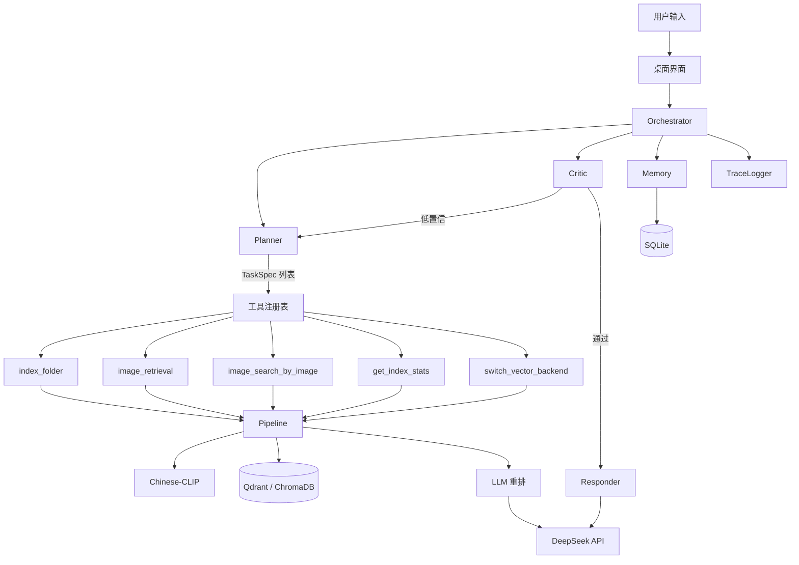

# 架构说明

## 四层总览

```
┌──────────────────────────────────────────────────────────────┐
│ 第四层  DevOps / 部署脚本                                      │
│         setup / deploy / 模型下载 / 评估 / 打包                │
├──────────────────────────────────────────────────────────────┤
│ 第三层  CLI 入口（给人用）                                     │
│         index / search / image / stats / serve / doctor       │
├──────────────────────────────────────────────────────────────┤
│ 第二层  Core Service（内核能力，不直接暴露给 Agent）            │
│         Pipeline · Searcher · Indexer · Encoder               │
├──────────────────────────────────────────────────────────────┤
│ 第一层  Agent 工具（给 LLM 调用）                              │
│         image_retrieval · image_search_by_image            │
│         index_folder · get_index_stats · switch_vector_backend│
├──────────────────────────────────────────────────────────────┤
│ 交互层  PyQt5 桌面应用 / Gradio（可选）                        │
└──────────────────────────────────────────────────────────────┘
```

一句话区分：

- **Agent 工具** = LLM 自主调用
- **CLI** = 人手动调用
- **Core Service** = 两者共用的底层实现，只维护一份

---

## 第一层：Agent 工具契约

工具是 Agent 的能力边界。LLM 只能调用这里注册的工具，参数与返回结构固定。

| 工具名 | 作用 | 参数 |
| --- | --- | --- |
| `image_retrieval` | 文本检索图片，完整链路：CLIP 编码 → 向量召回 → LLM 重排 | `query`、`top_k`、`folder_path`（可选） |
| `image_search_by_image` | 以图搜图 | `image_path`、`top_k`、`folder_path`（可选） |
| `index_folder` | 对指定文件夹增量构建索引 | `folder_path`、`rebuild=False` |
| `get_index_stats` | 查询索引统计：图片数量、向量库类型、设备 | 无 |
| `switch_vector_backend` | 切换向量后端（Chroma / Qdrant） | `backend_name` |
| `folder_scan` | 扫描文件夹并统计图片数量（辅助工具） | `path`、`recursive` |

工具层只做三件事：

1. 参数校验
2. 路径安全校验
3. 调用下层 Pipeline

CLIP 编码、向量库读写、重排这些逻辑一律不写在工具里。

新增工具只需：

1. 继承 `BaseTool`，定义 `name / description / args_schema / run`
2. 在 `tools/__init__.py` 导出
3. 在 `orchestrator.py` 的 `self.tools` 注册
4. 在 `configs/tools.yaml` 登记

---

## 第二层：Core Service

所有 Agent 工具和 CLI 命令共用的底层核心：

| 组件 | 职责 |
| --- | --- |
| `Pipeline` | 统一调度：组装编码器、向量库、重排器；提供 `stats`、`switch_backend`、`warmup` |
| `Searcher` | 文本检索、以图搜图、目录范围过滤 |
| `Indexer` | 索引构建、增量更新、去重、缺失清理 |
| `Encoder` | Chinese-CLIP 编码、BLIP 描述生成、LLM 重排 |

`Pipeline` 是唯一的组装点。CLI 和 Agent 都通过它访问检索能力，不会出现「CLI 能跑、Agent 跑不通」的版本分裂。

---

## 第三层：CLI 入口

面向开发者手动操作，和 Agent 工具并行，底层复用同一套 Core Service。

```bash
python cli.py index  D:\Photos --reset      # 手动建索引
python cli.py search "夕阳下的海边"          # 文本搜图
python cli.py image  D:\test.jpg            # 以图搜图
python cli.py stats                         # 索引统计
python cli.py serve                         # 启动 Gradio WebUI
python cli.py doctor                        # 环境自检
```

---

## 第四层：DevOps / 部署脚本

只负责环境、部署、模型资产、评估与打包，不属于业务能力。

| 类别 | 脚本 |
| --- | --- |
| 环境部署 | `setup.ps1` / `setup.sh`、`deploy-*.ps1`、`init_agent_config.py`、`install-ollama-portable.ps1` |
| 模型资产 | `download_models.py`、`download_llm_hf.py` |
| 数据集准备 | `prepare_test_dataset.py` |
| 评估与测试 | `evaluate.py`、`test_llm.py`、`test_agent_llm.py`、`test_agent_e2e.py` |
| 打包发布 | `build_package.ps1` |

评估与测试脚本属于测试资产，不要和检索、索引能力混在一起。

---

## 关键链路：自然语言带路径

用户说「帮我打开 D:/imgtest，找白色小猫」时：

```
① Planner 用正则 + LLM 提取路径与检索词
      path = D:/imgtest
      query = 白色小猫

② 单任务带显式路径 → 任务链拆成两步
      [scan]     index_folder(folder_path="D:/imgtest", rebuild=False)
      [retrieve] image_retrieval(query="白色小猫", folder_path="D:/imgtest")

③ Searcher 在召回后按路径前缀过滤
      只保留 D:/imgtest 下的结果

④ Responder 合成回复
```

多个任务时不再额外插「打开目录」步骤，每个任务保持一步，路径扫描在检索工具内部完成，避免步骤数量翻倍。

---

## 安全收口

所有接收路径的入口（Agent 工具、CLI、WebUI）统一走 `PathGuard`：

1. `resolve()` 展开 `..` 和符号链接
2. 命中系统目录（Windows / Program Files / ProgramData）直接拒绝
3. 必须落在允许的根目录内，默认「项目目录 + 用户主目录」
4. 越界路径不触发任何索引或检索动作

允许的根目录在 `configs/agent.yaml` 的 `security.allowed_roots` 配置。

---

## Agent 层内部

```
Orchestrator
├─ Planner   任务拆解与路径提取，输出 TaskSpec 列表
├─ Memory    对话记忆 + SQLite 轨迹
├─ Critic    置信校验 + 查询改写
└─ Responder 结果合成
```

`TaskSpec` 带 `action` 字段区分步骤类型：`scan` 扫描目录，`retrieve` 检索图片。

---

## 数据流



## 一次完整请求

1. 用户输入进入 `Orchestrator`
2. `Memory` 记录用户消息，取最近若干条作为上下文
3. `Planner` 正则提取路径、LLM 拆解任务，输出 `TaskSpec` 列表
4. 单任务带路径时拆成「扫描目录」「检索图片」两步；多任务每个任务一步
5. 按 `action` 调用对应工具：
   - `scan` → `folder_scan` / `index_folder`
   - `retrieve` → `image_retrieval`，携带 `folder_path` 限定范围
6. `Critic` 校验置信度，低于阈值则改写查询重试
7. `Responder` 生成自然语言回复，失败则模板兜底
8. `Memory` 写入回复与轨迹，`TraceLogger` 输出带 `trace_id` 的日志

## 关键设计

**面向接口的向量库。** `VectorStore` 抽象基类定义 `add/query/delete/get/count/reset/get_all_ids/close`，ChromaDB 与 Qdrant 各自实现。上层只依赖接口。

**LLM 实例共享。** Agent 的 Planner/Responder/Critic 与检索重排共用同一个 `ChatClient`，避免重复加载模型。

**降级优先于失败。** LLM 不可用时退回纯向量排序；描述缺失时跳过重排；工具异常时返回空结果而不是抛穿到界面。

**分数融合。** 向量相似度先做 min-max 归一化，再与 LLM 分数加权（默认 0.35 / 0.65）。

**配置与代码分离。** `configs/agent.yaml` 管 Agent 行为与提示词，`configs/tools.yaml` 管工具注册，`config.yaml` 管检索模型与向量库。带 Key 的 `agent.yaml` 不进 git、不进发布包。
