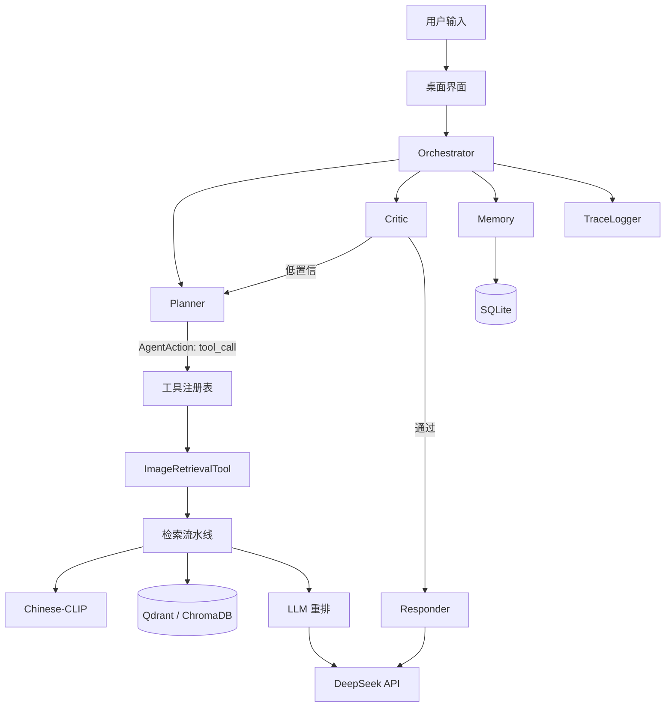

# 架构说明

## 分层

```
┌─────────────────────────────────────────────────────────┐
│ 交互层    PyQt5 桌面应用 / Gradio（可选） / CLI          │
├─────────────────────────────────────────────────────────┤
│ Agent 层  Orchestrator                                  │
│           ├─ Planner    ReAct 决策，输出 AgentAction     │
│           ├─ Memory     对话记忆 + SQLite 轨迹            │
│           ├─ Critic     置信校验 + 查询改写               │
│           └─ Responder  结果合成                         │
├─────────────────────────────────────────────────────────┤
│ 工具层    BaseTool → ImageRetrievalTool（可注册扩展）     │
├─────────────────────────────────────────────────────────┤
│ 检索层    Retriever Pipeline                            │
│           ├─ Chinese-CLIP  图文统一嵌入（512 维）         │
│           ├─ BLIP          图像描述                      │
│           ├─ VectorStore   ChromaDB / Qdrant 抽象        │
│           └─ LLM Reranker  DeepSeek / Ollama / 本地权重  │
├─────────────────────────────────────────────────────────┤
│ 基础层    config（YAML）、logger（trace_id）、schemas     │
└─────────────────────────────────────────────────────────┘
```

## 数据流



## 一次完整请求

1. 用户输入进入 `Orchestrator.run()`
2. `Memory` 记录用户消息，取最近 6 条作为上下文
3. `Planner` 调用 LLM，输出 `AgentAction`（tool_call / ask_user / answer）
4. 若是 tool_call，从工具注册表取 `ImageRetrievalTool`，执行检索：
   - CLIP 编码查询 → 向量库召回 Top-50 → LLM 重排 → 返回图片与置信度
5. `Critic` 校验置信度，低于阈值则让 LLM 改写查询重试（最多 `max_retries` 次）
6. `Responder` 用 LLM 生成自然语言回复，失败则模板兜底
7. `Memory` 写入助手回复与动作轨迹，`TraceLogger` 输出带 `trace_id` 的日志

## 关键设计

**面向接口的向量库。** `VectorStore` 抽象基类定义 `add/query/delete/get/count/reset/get_all_ids/close`，ChromaDB 与 Qdrant 各自实现。上层检索与索引只依赖接口，切换后端只改配置。

**LLM 实例共享。** Agent 的 Planner/Responder/Critic 与检索重排共用同一个 `ChatClient`，避免 transformers 后端重复加载模型到显存。

**降级优先于失败。** LLM 不可用时检索退回纯向量排序；描述缺失时跳过重排；工具异常时返回空结果而不是抛穿到界面。

**分数融合。** 向量相似度先做 min-max 归一化，再与 LLM 分数加权（默认 0.35 / 0.65），避免量纲差异导致 LLM 分数完全主导。

**配置与代码分离。** `configs/agent.yaml` 管 Agent 行为与提示词，`configs/tools.yaml` 管工具注册，`config.yaml` 管检索模型与向量库。带 Key 的 `agent.yaml` 不进 git、不进发布包。
